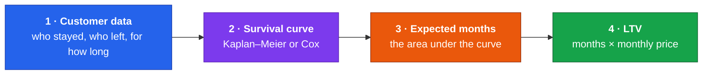

<div align="center">

# 📈 SubscriptionLTV

### How much is each subscriber still worth?

Predicting customer lifetime value (LTV) for a subscription business with **survival analysis**,<br/>
explained step by step in an interactive **Streamlit** app.


</div>

---

## 🎯 The idea

A subscription earns money only while the customer stays. So what a customer is still worth is:

```math
\text{LTV} = \text{monthly price} \times \text{expected remaining months}
```

The price is known. The remaining months are not: most customers are still active, so nobody knows yet when they will leave. **Survival analysis** is built for exactly that, and this project uses two of its models.

| | Model | What it gives |
| :---: | --- | --- |
| 🩷 | **Kaplan–Meier** | One survival curve shared by all customers |
| 🟣 | **Cox** | A survival curve for each customer, based on their traits |

---

## 🖥️ The app

```bash
pip install -r requirements.txt
streamlit run app.py
```

| Page | What it shows |
| --- | --- |
| 🎯 **The problem** | What we want to predict, and why the future is the hard part |
| 📉 **Kaplan–Meier** | The survival curve, the area under it, and the LTV for any tenure and plan |
| 🧮 **Step by step** | The same calculation on 100 subscribers, one visual step at a time |
| 👤 **Cox model** | The method applied to JFrog: from a company's traits to its predicted LTV |

---

## 🧭 How it works



**1 · Customer data.** For each customer: how many months they have been subscribed, and whether they have already left. Customers who are still active count too.

**2 · Survival curve.** The share of customers still subscribed after each month.

- **Kaplan–Meier** draws one curve for everyone.
- **Cox** gives each customer their own curve. Every trait multiplies the risk of leaving up or down.

**3 · Expected months.** The area under the curve is the expected time as a customer. For someone who has already stayed a while, only the months ahead count:

```text
Expected remaining months = area under the curve after today ÷ share of customers still here today
```

**4 · LTV.** Multiply the expected months by the monthly price.

---

## 🧮 A small example

100 subscribers join. Each month fewer are still here: **100, 70, 50, 40, 30, 25**.

Today is month 2, so **50** are still here. Looking 4 months ahead:

| Month from today | Still here | Share of today's 50 |
| :---: | :---: | :---: |
| 1 | 50 | 50 ÷ 50 = **1.0** |
| 2 | 40 | 40 ÷ 50 = **0.8** |
| 3 | 30 | 30 ÷ 50 = **0.6** |
| 4 | 25 | 25 ÷ 50 = **0.5** |

```text
Expected remaining months = 1.0 + 0.8 + 0.6 + 0.5 = 2.9
LTV at $15 a month        = 2.9 × $15             = $43.50
```

---

## 📊 Results with Kaplan–Meier

5,000 simulated subscribers, looking 36 months ahead, on a $15 plan:

| Months already subscribed | Subscribers who get this far | Expected remaining months | LTV |
| :---: | :---: | :---: | :---: |
| 0 | 100% | 23.4 | $351 |
| 12 | 69% | 27.3 | $410 |
| 24 | 56% | 28.8 | $432 |
| 36 | 47% | 29.6 | $444 |

> [!TIP]
> The longer a subscriber has stayed, the longer they are expected to stay. Most cancellations happen early, and a long-standing subscriber has already passed that risk.

---

## 🐸 Applied to JFrog

The fourth page applies the method to [JFrog](https://jfrog.com), in four steps.

> [!IMPORTANT]
> **An illustration.** The facts about JFrog are public and linked below. The companies, prices and forecasts are made up, and the method is my own proposal.

**1 · Why a survival model?** JFrog reported a gross retention of **97%** for the third quarter of 2026 ([earnings call][call]). Customers rarely leave, so most are still active and how long they will stay is not known yet.

**2 · A simple formula.** Each company pays a fixed annual price, divided by 12 to get a monthly price:

```text
Predicted LTV = monthly price × expected months as a customer
```

**3 · What goes into the model.** Five things we would know about each company:

| Company trait | Public information about JFrog | My assumption for the demo |
| --- | --- | --- |
| 📦 **Subscription plan** | Plans such as Pro, Enterprise X and Enterprise+ ([pricing][pricing]) | Companies on higher plans stay longer |
| 🌐 **Where it runs** | In JFrog's cloud, or hosted by the customer ([10-Q][10q]) | Cloud customers leave a little more easily |
| 🏢 **Company size** | Customers include over 80% of the Fortune 100 ([home page][home]) | Large companies stay longer |
| 🧩 **Products in use** | Security and other products are added on top of Artifactory ([pricing][pricing]) | Each extra product lowers the risk of leaving |
| 📉 **Usage trend** | Cloud subscriptions can include usage-based fees ([10-Q][10q]) | Falling usage is a warning sign |

**4 · A forecast for every company.** Company traits → Cox model → expected months → predicted LTV.

| Company | Main traits | Monthly price | Expected months | Predicted LTV |
| --- | --- | :---: | :---: | :---: |
| **A** · Small team | Pro, cloud, usage falling | $200 | 23.6 | $4,720 |
| **B** · Growing scale-up | Enterprise X, cloud, 2 products | $1,000 | 31.9 | $31,900 |
| **C** · Large enterprise | Enterprise+, self-managed, 3 products | $10,000 | 34.7 | $347,000 |
| **D** · Enterprise at risk | Enterprise+, cloud, usage falling | $10,000 | 30.6 | $306,000 |

Companies C and D pay the same price and are still worth different amounts. The Cox model tells them apart.

---

## 🗂️ Project structure

```text
app.py                          Entry point and page navigation
app_pages/
    problem.py                  Page 1 · The problem
    kaplan_meier.py             Page 2 · Kaplan–Meier curve and LTV
    conditional_expectation.py  Page 3 · The calculation, step by step
    cox.py                      Page 4 · Cox model, applied to JFrog
data.py                         Simulated subscribers for the Kaplan–Meier page
jfrog.py                        Simulated companies for the Cox page
survival.py                     Kaplan–Meier, Cox, and the area under a survival curve
charts.py                       Survival charts shared by the pages
loaders.py                      Cached data for the pages
ui.py                           Shared colours and page components
```

---

## ⚠️ Good to know

- **Simulated data.** Every customer in this project is made up. The figures show how the method works, not real business results.
- **36-month horizon.** Months beyond the next 3 years are not counted, so LTV is a cautious estimate.
- **Fixed price, no discounting.** The price never changes, and a future dollar counts the same as a dollar today.
- **Cox assumption.** The Cox model assumes each trait changes the risk of leaving by the same factor at every tenure. That holds here because the data was simulated that way. With real data it has to be tested.

---

## 📚 Sources

- [JFrog home page][home]
- [JFrog pricing page][pricing]
- [JFrog third quarter 2026 earnings call transcript][call]
- [JFrog Form 10-Q for the third quarter of 2026][10q]
- [lifelines documentation: survival regression](https://lifelines.readthedocs.io/en/latest/Survival%20Regression.html)

[home]: https://jfrog.com
[pricing]: https://jfrog.com/pricing/
[call]: https://s21.q4cdn.com/528621000/files/content_files/JFrog-Third-Quarter-2026-Financial-Results-Conference-Call_Transcript_Corrected.pdf
[10q]: https://d18rn0p25nwr6d.cloudfront.net/CIK-0001800667/d24cc365-8c8a-4964-b0b4-340de1e9da48.pdf
