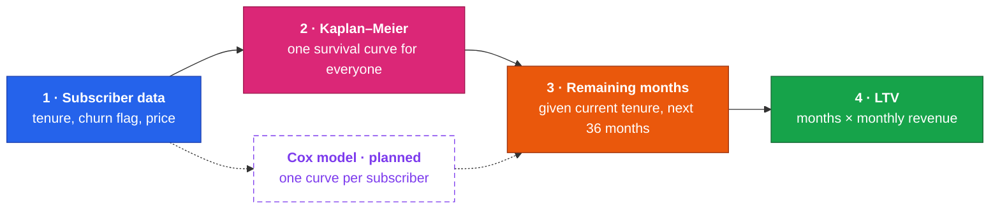

<div align="center">

# 📈 SubscriptionLTV

### How much is each subscriber still worth?

Predicting customer lifetime value for a subscription service with **survival analysis**,<br/>
explained step by step in an interactive **Streamlit** app.


</div>

---

## 🎯 The idea

A subscription earns money only while the customer stays, so a subscriber's future value is:

```math
\text{LTV} = \text{monthly revenue} \times \text{expected remaining months}
```

The monthly revenue is known. The remaining months are not, and estimating them is the whole problem.

> [!NOTE]
> **Why survival analysis?**
> An active subscriber has not cancelled *yet*, so their final subscription length is unknown. We only know it is *at least* their current tenure. Survival analysis uses that partial information correctly. Dropping active subscribers, or treating their current tenure as final, would understate how long subscribers stay.

---

## 🖥️ The app

```bash
pip install -r requirements.txt
streamlit run app.py
```

| Page | What it shows |
| --- | --- |
| 🎯 **The problem** | What we want to predict, and why the future is the hard part |
| 📉 **Kaplan–Meier** | The survival curve, the area under it, and the LTV for any tenure and plan |
| 🧮 **Step by step** | The same calculation on 100 subscribers, one visual step at a time |

---

## 🧭 How it works



### 🔵 1 · Subscriber data

5,000 synthetic subscribers of a service that has been running for 84 months. About half have already cancelled.

| Column | Meaning |
| --- | --- |
| `plan`, `monthly_price` | Basic $10, Standard $15 or Premium $20 |
| `channel`, `promo_signup`, `weekly_hours` | How they joined and how much they use the service |
| `tenure_months` | Months subscribed so far |
| `churned` | `1` if the subscriber cancelled, `0` if still active |

Churn times are drawn from a known risk model, so a fitted model can later be checked against the true effects.

### 🩷 2 · Kaplan–Meier survival curve

Kaplan–Meier asks one thing at every point in time: of the subscribers who were still here, what share stayed? Multiplying those shares gives the survival curve, the probability of still being subscribed after *t* months.

```math
\hat{S}(t) = \prod_{t_i \le t} \left(1 - \frac{d_i}{n_i}\right)
```

| Symbol | Meaning |
| --- | --- |
| `nᵢ` | Subscribers still here just before time *tᵢ* |
| `dᵢ` | Subscribers among them who cancelled at *tᵢ* |

Active subscribers count in `nᵢ` for as long as they have been observed, and are never treated as churned.

### 🟠 3 · Expected remaining months

A subscriber who has reached month *t₀* has already survived everything before it. So the curve is cut at *t₀* and rescaled to start again at 100%:

```math
S(t_0 + u \mid T > t_0) = \frac{S(t_0 + u)}{S(t_0)}
```

The area under this re-based curve over the next 36 months is the expected time the subscriber will still be here:

```math
\text{Expected remaining months} = \int_{0}^{36} \frac{S(t_0 + u)}{S(t_0)} \, du
```

### 🟢 4 · LTV

```math
\text{LTV} = \text{monthly revenue} \times \text{expected remaining months}
```

---

## 🧮 A small example

100 subscribers join. Each month fewer are still here: **100, 70, 50, 40, 30, 25**.

Today is month 2, so **50** subscribers are still here, and we look 4 months ahead.

| Month from today | Still here | Share of today's 50 |
| :---: | :---: | :---: |
| 1 | 50 | 50 ÷ 50 = **1.0** |
| 2 | 40 | 40 ÷ 50 = **0.8** |
| 3 | 30 | 30 ÷ 50 = **0.6** |
| 4 | 25 | 25 ÷ 50 = **0.5** |

```text
Expected remaining months = 1.0 + 0.8 + 0.6 + 0.5 = 2.9
LTV at $15 a month        = 2.9 × $15             = $43.50
```

Each month is one unit wide, so adding the shares is the same as measuring the area under the curve.

---

## 📊 What the baseline says

Kaplan–Meier results on the synthetic data, over a 36-month horizon:

| Months already subscribed | Subscribers who get this far | Expected remaining months | LTV on Standard ($15) |
| :---: | :---: | :---: | :---: |
| 0 | 100% | 23.4 | $351 |
| 12 | 69% | 27.3 | $410 |
| 24 | 56% | 28.8 | $432 |
| 36 | 47% | 29.6 | $444 |

> [!TIP]
> The longer a subscriber has stayed, the longer they are expected to stay. Most cancellations happen early, and a long-standing subscriber has already passed that risk.

---

## 🟣 Next: the Cox model

Kaplan–Meier gives **one curve for everyone**: two subscribers with the same tenure get the same forecast, whatever their plan or behaviour. The Cox proportional hazards model removes that limit by scaling a shared underlying risk with each subscriber's features:

```math
h(t \mid x) = h_0(t) \cdot \exp(\beta^\top x)
\qquad\Longrightarrow\qquad
S(t \mid x) = S_0(t)^{\exp(\beta^\top x)}
```

Each coefficient reads as a **hazard ratio**: 1.5 means 50% higher churn risk at any moment, 0.7 means 30% lower.

In the small example above, a subscriber with twice the churn risk would have each share raised to the power of 2:

```text
Expected remaining months = 1.0² + 0.8² + 0.6² + 0.5² = 2.25   (instead of 2.9)
```

| | 🩷 Kaplan–Meier | 🟣 Cox |
| --- | --- | --- |
| **Survival curve** | One for everyone | One per subscriber |
| **Explains churn** | No | Yes, through hazard ratios |
| **Assumptions** | None about the curve | Proportional hazards |
| **Status** | Built | Planned |

---

## 🗂️ Project structure

```text
app.py                          Entry point and page navigation
app_pages/
    problem.py                  Page 1 · The problem
    kaplan_meier.py             Page 2 · Kaplan–Meier curve and LTV
    conditional_expectation.py  Page 3 · The calculation, step by step
data.py                         Synthetic subscriber generator
survival.py                     Survival curve, re-basing and area under the curve
ui.py                           Shared colours and page components
```

---

## ⚙️ Design choices

| Choice | Decision | Why |
| --- | --- | --- |
| **Baseline** | Kaplan–Meier | Simple, assumes nothing about the shape of the curve, and shows what a richer model adds |
| **Horizon** | 36 months | A survival curve rarely reaches zero inside the observed data, so the forecast needs a clear cut-off |
| **Discounting** | None | Keeps LTV directly readable as months × price |
| **Data** | Synthetic | The true churn drivers are known, so models can be validated against them |

---

## ⚠️ Assumptions and limits

- **Synthetic data.** The project demonstrates the method. The figures are not results from a real business.
- **Bounded value.** Revenue beyond 36 months is not counted, so LTV is a deliberately conservative estimate.
- **Constant price.** Monthly revenue is assumed to stay fixed, with no upgrades or downgrades.
- **Long-tenured subscribers.** The curve is only reliable where enough subscribers have been observed. The app therefore covers tenures up to 36 months; beyond that the 36-month window needs an explicit extrapolation rule, which is not decided yet.
- **One curve for everyone.** Until the Cox model is added, the forecast depends only on tenure and price.

---

## 🗺️ Roadmap

- [x] Define the approach
- [x] Generate synthetic subscriber data
- [x] Kaplan–Meier baseline and baseline LTV
- [x] App pages: the problem, Kaplan–Meier, step by step
- [ ] Fit and validate the Cox model
- [ ] Personal LTV for every subscriber, compared with the baseline
- [ ] App pages for the Cox model
